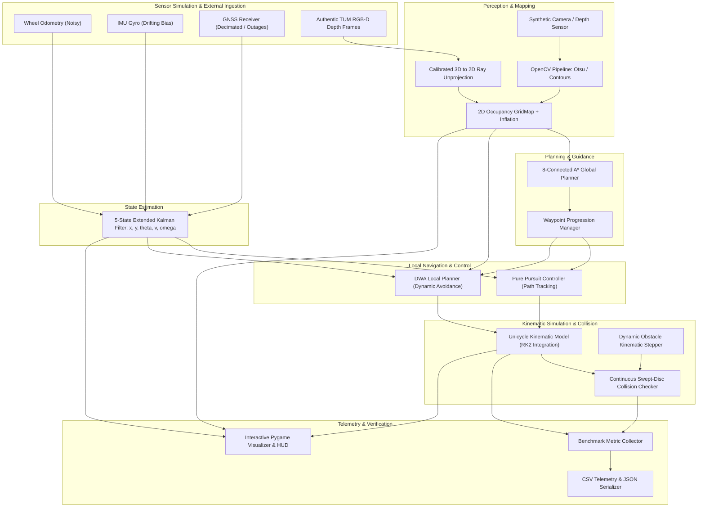
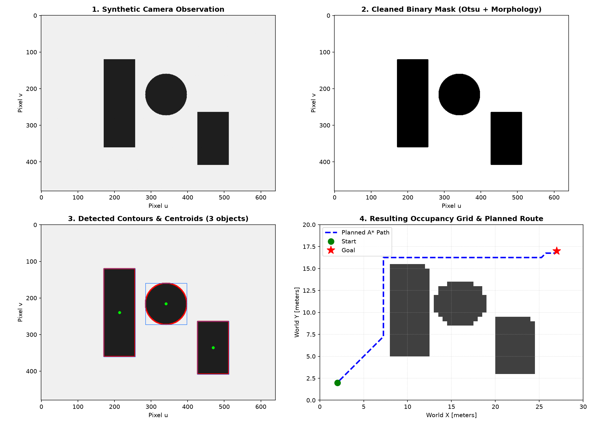
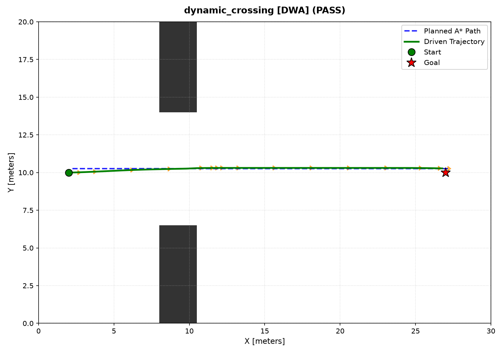
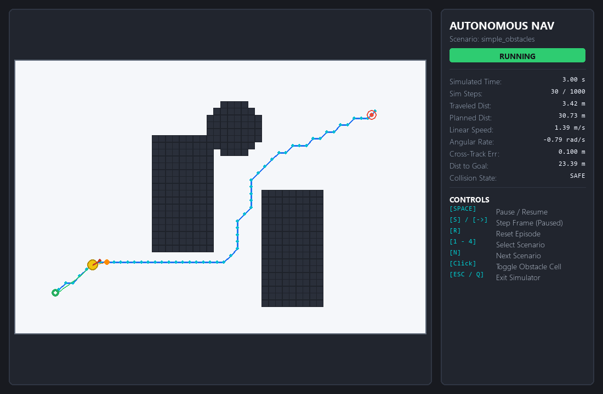
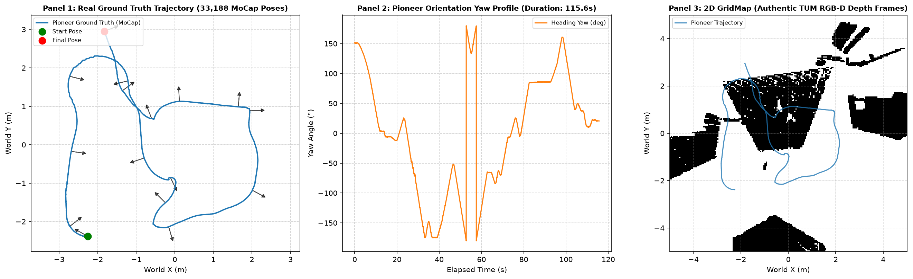
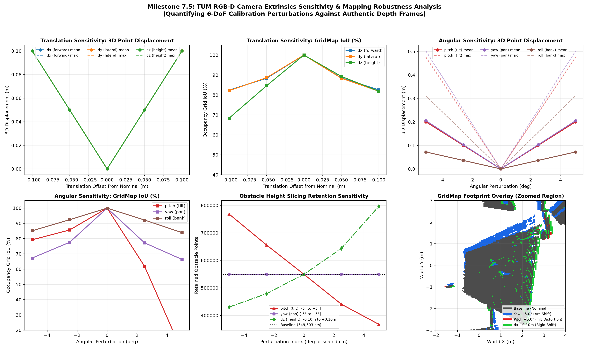

# AI-Based Autonomous Navigation System

[](https://www.python.org/downloads/)
[](docs/testing.md)
[](docs/results.md)
[](docs/architecture.md)

An end-to-end simulation-first autonomous mobile robot navigation framework built in Python. Features classical OpenCV vision perception and obstacle detection, interactive 2D Pygame simulation GUI with real-time telemetry, 2D discrete occupancy grid mapping, 8-connected A* global path planning with corner-cutting prevention, Dynamic Window Approach (DWA local planner) with spatiotemporal dynamic collision avoidance, synthetic sensor noise modeling (odometry, IMU gyro drift, GNSS decimation and outages), 5-state Extended Kalman Filter (EKF state estimation), adaptive Pure Pursuit tracking with curvature-based velocity modulation, exact geometric continuous collision checking, and automated benchmark scoring.

---

## Project Overview

Autonomous mobile robots operating in cluttered dynamic environments require tightly coupled perception, state estimation, path planning, and local collision avoidance subsystems. Developing and verifying these systems directly on physical hardware can be slow, hazardous, and difficult to reproduce under edge cases.

This repository implements a modular, simulation-first autonomous navigation framework engineered to run reproducibly on standard workstations without external heavy simulators or live ROS runtimes. The architecture enforces separation of concerns across perception, estimation, planning, and control, allowing each subsystem to be benchmarked in isolation or as an integrated closed-loop stack.

The primary operational domain is planar 2D ground navigation, complemented by an experimental real-world RGB-D projection pipeline that ingests authentic depth frames from the TUM RGB-D Benchmark to generate 2D occupancy maps under calibrated kinematic transformations.

---

## Key Features

| Capability | Module | Description |
| :--- | :--- | :--- |
| **Global Path Planning** | `autonomous_nav.planning.astar` | 8-connected A* search algorithm featuring octile distance heuristics, obstacle inflation, and strict diagonal corner-cutting prevention. |
| **Local Obstacle Avoidance** | `autonomous_nav.navigation.dwa` | Dynamic Window Approach (DWA) evaluating forward circular arc trajectories across dynamic acceleration and velocity windows against moving obstacles. |
| **Path Tracking Control** | `autonomous_nav.navigation.controller` | Adaptive Pure Pursuit controller with curvature-dependent lookahead distance and speed modulation for smooth path following. |
| **Occupancy Grid Mapping** | `autonomous_nav.environment.grid_map` | Discrete 2D occupancy grid with Euclidean distance transform inflation, world-to-grid coordinate conversions, and safe boundary clipping. |
| **State Estimation & Fusion** | `autonomous_nav.estimation.ekf` | 5-state Extended Kalman Filter ($x, y, \theta, v, \omega$) fusing wheel odometry, drifting IMU angular rate, and decimated GNSS fixes with Joseph-form covariance updates. |
| **Sensor Simulation** | `autonomous_nav.sensors.sensor_models` | Realistic sensor synthesis modeling Gaussian odometry noise, IMU random walk and bias drift, GNSS rate decimation, and scheduled GNSS outage intervals. |
| **Vision Perception** | `autonomous_nav.perception` | Classical OpenCV perception pipeline incorporating Otsu thresholding, morphological filtering, contour extraction, and camera-to-grid map projection. |
| **Spatiotemporal Collision** | `autonomous_nav.simulation.collision` | Continuous swept-disc collision detection eliminating temporal tunneling between discrete simulation integration steps. |
| **Simulation Bridge** | `autonomous_nav.bridge` | Interface adhering to REP-103 and REP-105 standards with an offline deterministic test adapter for CI verification. |
| **Real-World RGB-D Evaluation** | `autonomous_nav.datasets` | Ingestion of authentic TUM RGB-D depth frames, pinhole ray unprojection, height slicing, and 2D grid map rasterization. |
| **Interactive GUI Simulator** | `autonomous_nav.visualization.animate` | Real-time 2D Pygame visualizer featuring live telemetry HUD, covariance error ellipses, manual obstacle editing, and scenario hot-swapping. |

---

## System Architecture

The framework is organized as a layered pipeline with strict data boundaries. Ground-truth states are isolated from estimation, and high-level global plans guide local reactive controllers.



### Subsystem Interaction
1. **Perception**: Raw depth frames or synthetic images are segmented and projected into a metric 2D occupancy grid where obstacle cells undergo safety radius inflation.
2. **Global Planning**: The A* planner computes an optimal 8-connected path from start to goal coordinates while strictly forbidding diagonal cutting across obstacle corners.
3. **State Estimation**: The vehicle state ($x, y, \theta, v, \omega$) is tracked by an EKF that fuses noisy wheel odometry with gyro rate and intermittent GNSS position observations.
4. **Local Control & Avoidance**: The waypoint manager samples target lookahead points along the global path. The DWA local planner evaluates candidate velocity-yawrate pairs $(v, \omega)$ over a short horizon to steer clear of static and moving obstacles.
5. **Kinematic Integration**: Commanded velocities drive an RK2-integrated unicycle model, checked at each step by continuous relative distance collision routines to eliminate tunneling.

---

## Technology Stack

| Category | Component | Technology / Implementation |
| :--- | :--- | :--- |
| **Core Runtime** | Programming Language | Python 3.11+ |
| **Numerical Processing** | Linear Algebra & Math | NumPy, SciPy |
| **Computer Vision** | Image Processing | OpenCV (cv2) |
| **Visualization** | Static Plots & Reporting | Matplotlib |
| **Interactive GUI** | Telemetry HUD & Controls | Pygame |
| **Testing & Quality** | Test Runner & Coverage | pytest, pytest-cov |
| **Packaging & Standards** | Build System & Specs | pyproject.toml, REP-103, REP-105 |

---

## Repository Structure

```
AI-Based Autonomous Navigation System/
├── .gitattributes             # Git LF line-ending normalization & binary attributes
├── .gitignore                 # Exclusion rules for virtualenv, caches, and outputs
├── CONTRIBUTING.md            # Contribution guidelines, coding standards, and testing policy
├── pyproject.toml             # Build system metadata, package specification, pytest configuration
├── requirements.txt           # Minimal core runtime dependencies (numpy, matplotlib, opencv, pygame)
├── requirements-dev.txt       # Development and test dependencies (pytest, pytest-cov)
├── configs/                   # Parameter configurations
│   └── default_config.json    # Baseline simulation, map, robot, and controller settings
├── data/                      # Maps, recorded telemetry, and dataset fixtures
│   ├── maps/                  # Static grid map definitions (.gitkeep)
│   ├── samples/               # Recorded trajectory & sensor samples (.gitkeep)
│   ├── tum_rgbd/              # TUM RGB-D benchmark dataset fixtures & documentation
│   └── README.md              # Documentation of data schemas and map storage
├── docs/                      # Central technical documentation hub
│   ├── README.md              # Master documentation index
│   ├── architecture.md        # 2D simulation-first subsystem architecture and flowcharts
│   ├── installation.md        # Environment setup, dependencies, and verification guide
│   ├── methodology.md         # Mathematical models: GridMap, A*, Kinematics, Pure Pursuit, DWA
│   ├── testing.md             # 4-tier test architecture and verification protocols
│   ├── results.md             # Benchmark scores and error analysis across static and dynamic scenarios
│   ├── limitations.md         # Planar assumptions, kinematics scope, and known boundaries
│   ├── roadmap.md             # Progressive development milestones (Perception, GUI, DWA, CARLA)
│   ├── execution_log.md       # Chronological milestone log and test verification tracker
│   └── [01-06]_*.md           # Advanced theoretical & multi-sensor system specifications
├── images/                    # Curated visual evidence for documentation & showcase
│   ├── .gitkeep               # Directory tracker
│   ├── calibration_sensitivity_diagnostic.png
│   ├── dataset_evaluation_diagnostic.png
│   ├── dynamic_crossing_dwa.png
│   ├── interactive_sim_screenshot.png
│   ├── perception_demo.png
│   └── simple_obstacles_trajectory.png
├── notebooks/                 # Research prototyping and exploratory notebooks
│   └── README.md              # Jupyter notebook guidelines and prototyping index
├── outputs/                   # Machine-generated run artifacts (ignored by git)
│   ├── figures/               # Rendered trajectory and grid map PNGs
│   ├── logs/                  # Telemetry CSV time-series recordings
│   ├── metrics/               # Evaluation summary JSON benchmark reports
│   └── README.md              # Output artifact lifecycle and gitignore retention policy
├── scripts/                   # Executable entry points
│   ├── run_simulation.py      # Run a single autonomous navigation scenario with live plot
│   ├── run_experiments.py     # Batch benchmark runner across all static scenarios
│   ├── run_dynamic_benchmarks.py # Comparative dynamic obstacle runner: Pure Pursuit vs DWA
│   ├── run_estimation_benchmark.py # State estimation benchmark: Ground Truth vs DR vs EKF vs Outage
│   ├── run_perception_demo.py # Vision pipeline demo: synthetic scene -> detection -> GridMap -> A*
│   ├── run_dataset_evaluation.py # TUM RGB-D real-world dataset ground truth tracking & depth mapping
│   ├── run_calibration_sensitivity.py # 6-DoF camera extrinsics perturbation sensitivity analysis
│   └── run_interactive.py     # Interactive 2D Pygame simulation GUI with HUD dashboard
├── src/autonomous_nav/        # Production Python package
│   ├── __init__.py            # Top-level exports and package version
│   ├── config.py              # Typed configuration dataclasses (Sensors, EKF, DWA, Map, Robot)
│   ├── main.py                # Command-line interface entry point with --feedback support
│   ├── bridge/                # High-fidelity simulation bridge & offline test adapter
│   │   ├── config.py          # BridgeConfig (frames, velocity limits, LiDAR parameters)
│   │   ├── contracts.py       # Standardized 3D state, command & sensor observation contracts
│   │   ├── interface.py       # SimulationBridge abstract lifecycle & observation interface
│   │   ├── mapping.py         # 3D-to-2D projections, EKF sensor extraction, LiDAR grid projection
│   │   └── mock_adapter.py    # OfflineTestAdapter (deterministic in-process mock for CI/testing)
│   ├── datasets/              # Real-world benchmark dataset adapters & processing
│   │   ├── adapter.py         # TUM RGB-D dataset adapter and trajectory evaluation pipeline
│   │   ├── config.py          # Camera intrinsics, extrinsics, and DatasetConfig
│   │   ├── depth_projection.py# Depth unprojection, camera-to-body transforms, and GridMap rasterization
│   │   └── groundtruth.py     # Ground truth motion-capture trajectory parser & SLERP interpolator
│   ├── environment/           # Grid mapping and benchmark scenario loader
│   │   ├── dynamic_obstacle.py# Moving dynamic obstacles and spatiotemporal trajectory prediction
│   │   ├── grid_map.py        # 2D occupancy grid, coordinates conversion, obstacle inflation
│   │   └── scenarios.py       # Predefined scenarios: static + dynamic crossing, corridor, chokepoint
│   ├── estimation/            # State estimation & sensor fusion
│   │   └── ekf.py             # 5-State Extended Kalman Filter with analytical Jacobians & Joseph updates
│   ├── evaluation/            # Metrics calculation & telemetry logging
│   │   ├── logger.py          # Step-by-step CSV telemetry and summary JSON serializer
│   │   └── metrics.py         # Path efficiency, cross-track error, smoothness, and estimation RMSE/MAE
│   ├── navigation/            # Trajectory tracking, local planning & waypoint management
│   │   ├── controller.py      # Adaptive Pure Pursuit tracking controller
│   │   ├── dwa.py             # Dynamic Window Approach (DWA) local planner
│   │   └── waypoint_manager.py# Waypoint progression, lookahead extraction, goal detection
│   ├── perception/            # Computer vision and obstacle perception (OpenCV)
│   │   ├── map_adapter.py     # Adapter projecting vision detections into GridMap
│   │   ├── obstacle_detection.py # Otsu thresholding, contours, moments, area filtering
│   │   ├── preprocessing.py   # Grayscale conversion, blurring, intensity normalization
│   │   └── vision.py          # Orthographic/Perspective cameras and synthetic renderer
│   ├── planning/              # Global path planning
│   │   └── astar.py           # 8-connected A* algorithm with corner-cutting prevention
│   ├── sensors/               # Synthetic sensor generation and noise models
│   │   └── sensor_models.py   # Wheel odometry, IMU gyro drift, GNSS decimation & outages, SensorSuite
│   ├── simulation/            # Kinematic integration & collision detection
│   │   ├── collision.py       # Circle-to-AABB exact collision checking & clearance
│   │   ├── engine.py          # Closed-loop simulation orchestrator (Pure Pursuit & DWA, GT & EKF feedback)
│   │   └── robot.py           # Unicycle kinematic model with RK2 integration
│   └── visualization/         # Plotting & graphic display
│       ├── animate.py         # Interactive 2D Pygame visualizer with live telemetry HUD
│       └── plot_map.py        # Matplotlib static trajectory and map rendering
└── tests/                     # Automated test suites (pytest)
    ├── conftest.py            # Common pytest fixtures
    ├── integration/           # Multi-subsystem closed-loop integration tests
    ├── scenarios/             # Benchmark scenario validation tests
    └── unit/                  # Isolated mathematical and component unit tests
```

---

## Installation and Setup

The project is developed for Windows workstations and standard POSIX environments using Python 3.11+. Follow these steps to establish a clean, isolated virtual environment.

### 1. Prerequisites
- Python 3.11 or higher installed on your system.
- PowerShell or command shell with access to Python.

### 2. Virtual Environment Setup
Open PowerShell in the project root directory and initialize the local virtual environment:

```powershell
# Create local virtual environment
python -m venv .venv

# Activate the virtual environment
.\.venv\Scripts\Activate.ps1
```

### 3. Install Package Dependencies
Install the package in editable mode along with runtime and test dependencies:

```powershell
# Install core runtime dependencies in editable mode
pip install -e .

# Install development and test dependencies
pip install -r requirements-dev.txt
```

### 4. Verify Installation
Verify that the test suite executes cleanly and all unit tests pass:

```powershell
python -m pytest tests/ -v
```

---

## How to Run

All executable workflows are accessible through dedicated scripts located in the `scripts/` directory.

### 1. Run Baseline Simulation
Execute a closed-loop navigation episode on the obstacle avoidance scenario and generate trajectory artifacts:

```powershell
python scripts/run_simulation.py --scenario simple_obstacles --plot
```

### 2. Run Batch Benchmark Suite Across All Static Scenarios
Run automated benchmarks evaluating path efficiency, cross-track error, and execution time across all static benchmark maps:

```powershell
python scripts/run_experiments.py
```

### 3. Run Computer Vision Perception Demo
Execute the classical OpenCV perception pipeline on synthetic sensor input, detect obstacle contours, update the grid map, and solve A* path planning:

```powershell
python scripts/run_perception_demo.py
```

### 4. Run Interactive 2D Simulator GUI (Pygame)
Launch the real-time simulation GUI featuring live HUD metrics, dynamic obstacle avoidance, and manual interactive controls:

```powershell
python scripts/run_interactive.py --scenario dynamic_crossing --mode dwa
```

**Interactive Keyboard & Mouse Controls:**
- `[SPACE]` : Pause or resume simulation
- `[M]` : Toggle navigation controller (`pure_pursuit` vs `dwa`)
- `[E]` : Toggle state estimation mode (`ground_truth` vs `ekf` vs `dead_reckoning`)
- `[S]` or `[->]` : Step simulation forward by one time step when paused
- `[R]` : Reset current scenario episode
- `[1 - 7]` : Switch scenario (`1: empty_field`, `2: simple_obstacles`, `3: corridor_s_bend`, `4: urban_grid`, `5: dynamic_crossing`, `6: dynamic_corridor`, `7: dynamic_chokepoint`)
- `[N]` : Cycle to next scenario
- `[Mouse Click]` : Add or remove obstacle cells interactively (triggers instant A* replanning)
- `[ESC]` or `[Q]` : Safely exit simulator

### 5. Run Dynamic Obstacle Benchmark
Evaluate comparative navigation performance between static Pure Pursuit and reactive DWA under dynamic obstacles:

```powershell
python scripts/run_dynamic_benchmarks.py
```

### 6. Run State Estimation Benchmark
Execute multi-trial state estimation benchmarks comparing Ground Truth, Dead Reckoning, EKF Fusion, and GNSS Outage conditions across multiple random seeds:

```powershell
python scripts/run_estimation_benchmark.py
```

### 7. Run Authentic TUM RGB-D Dataset Evaluation
Process authentic depth frames from the TUM Pioneer RGB-D dataset, project 3D points, slice height bands, and rasterize a metric 2D occupancy grid:

```powershell
python scripts/run_dataset_evaluation.py
```

### 8. Run Extrinsic Calibration Sensitivity Analysis
Evaluate the geometric sensitivity of 2D map rasterization against 6-DoF camera mounting perturbations ($d_x, d_y, d_z$, pitch, yaw, roll):

```powershell
python scripts/run_calibration_sensitivity.py
```

### 9. Run Full Automated Test Suite with Coverage
Run all 203 automated unit, integration, and scenario tests with branch coverage reporting:

```powershell
python -m pytest --cov=src/autonomous_nav -v
```

---

## Results and Evaluation

The framework has been quantitatively verified through reproducible benchmark suites spanning path efficiency, obstacle avoidance under dynamic motion, sensor noise filtering, and real-world RGB-D projection.

### 1. Static Scenario Benchmark Suite (`PurePursuitController`)

Evaluated on static occupancy grids with resolution $0.1\text{ m}$:

| Scenario | Status | Planned Path | Actual Trajectory | Mean CTE | Max CTE | Collisions | Sim Duration |
| :--- | :--- | :--- | :--- | :--- | :--- | :--- | :--- |
| **`empty_field`** | **PASS** | $26.21\text{ m}$ | $25.79\text{ m}$ | $0.052\text{ m}$ | $0.354\text{ m}$ | $0$ | $18.9\text{ s}$ |
| **`simple_obstacles`** | **PASS** | $30.73\text{ m}$ | $29.50\text{ m}$ | $0.075\text{ m}$ | $0.354\text{ m}$ | $0$ | $21.6\text{ s}$ |
| **`corridor_s_bend`** | **PASS** | $30.73\text{ m}$ | $29.27\text{ m}$ | $0.086\text{ m}$ | $0.342\text{ m}$ | $0$ | $21.5\text{ s}$ |
| **`urban_grid`** | **PASS** | $35.00\text{ m}$ | $34.79\text{ m}$ | $0.016\text{ m}$ | $0.354\text{ m}$ | $0$ | $24.7\text{ s}$ |

All static scenarios achieve a 100% success rate with zero collisions. Path efficiency ratio remains above $0.98$, and cross-track error remains tightly bounded throughout.

### 2. Dynamic Obstacle Avoidance Benchmark (Pure Pursuit vs DWA Local Planner)

Evaluated across 18 deterministic trials (9 trials per mode across nominal, $-20\%$ slower, and $+20\%$ faster obstacle velocities):

| Navigation Mode | Total Trials | Successes | Success Rate | Dynamic Collisions | Collision Rate | Total Failures | Mean Sim Loop Time |
| :--- | :--- | :--- | :--- | :--- | :--- | :--- | :--- |
| **`pure_pursuit`** (Baseline) | $9$ | $3$ | **$33.3\%$** | $6$ | **$66.7\%$** | $0$ | **$0.011\text{ s}$** |
| **`dwa`** (Local Planner) | $9$ | $9$ | **$100.0\%$** | $0$ | **$0.0\%$** | $0$ | **$2.591\text{ s}$** |

*Analysis*: Pure Pursuit executes open-loop tracking along the static A* path without dynamic obstacle awareness, succeeding only when obstacles clear the robot path by chance. DWA continuously evaluates dynamic velocity windows, yielding a 100% arrival rate with zero collisions.

### 3. State Estimation and Sensor Fusion Benchmark

Evaluated across 36 trials (3 scenarios $\times$ 4 feedback modes $\times$ 3 random seeds: `42`, `43`, `44`):

| Feedback Mode | Navigation Success | Position RMSE | Max Position Error | Heading RMSE | Latency (Mean / P95) | Estimation Characteristics |
| :--- | :--- | :--- | :--- | :--- | :--- | :--- |
| **Ground Truth** | **$9 / 9$ ($100.0\%$)** | **$0.0000\text{ m}$** | **$0.0000\text{ m}$** | **$0.00^\circ$** | $0.047\text{ ms} / 0.079\text{ ms}$ | Exact simulation state baseline |
| **Dead Reckoning** | **$9 / 9$ ($100.0\%$)** | $0.2676\text{ m}$ | $0.8013\text{ m}$ | $1.43^\circ$ | $0.041\text{ ms} / 0.053\text{ ms}$ | Unbounded drift over extended runs |
| **EKF Fusion** | **$9 / 9$ ($100.0\%$)** | **$0.2522\text{ m}$** | **$0.5992\text{ m}$** | **$0.84^\circ$** | $0.046\text{ ms} / 0.074\text{ ms}$ | Drift bounded by GNSS ($\sigma = 0.25\text{ m}$) |
| **EKF Outage (5s)** | $8 / 9$ ($88.9\%$) | $0.6223\text{ m}$ | $1.5091\text{ m}$ | $2.14^\circ$ | $0.048\text{ ms} / 0.074\text{ ms}$ | Dead-reckoning drift during outage |

*Analysis*: On long multi-turn scenarios such as `urban_grid`, EKF fusion reduces dead-reckoning drift by +23.7% ($0.3267\text{ m} \to 0.2494\text{ m}$ RMSE). Overall aggregate EKF RMSE reduction across all trials is +5.8%, maintaining heading accuracy within $0.84^\circ$.

### 4. Authentic TUM RGB-D Dataset Evaluation

Evaluated using authentic depth frames and 100 Hz motion capture ground truth from the `freiburg2_pioneer_slam2` sequence:

| Metric Category | Measured Value | Accounting & Reconciliation |
| :--- | :--- | :--- |
| **Frames Processed** | $5$ authentic frames | 16-bit depth PNGs from sequence archive |
| **Total Input Pixels** | $1,536,000$ pixels | Exactly $5 \times (480 \times 640)$ |
| **Zero-Depth Dropouts** | $263,277$ pixels ($17.14\%$) | Pinhole invalid / absorption dropouts |
| **Out-of-Range Pixels** | $276,529$ pixels ($18.00\%$) | $Z < 0.5\text{ m}$ or $Z > 5.0\text{ m}$ |
| **Valid Depth Pixels** | $996,194$ pixels ($64.86\%$) | Sum matches total pixel budget identically |
| **Floor Rejected Points** | $317,217$ points ($31.84\%$) | $Z_b < 0.05\text{ m}$ ground plane cutoff |
| **Ceiling Rejected Points** | $129,474$ points ($13.00\%$) | $Z_b > 1.20\text{ m}$ overhead cutoff |
| **Retained Obstacle Points** | $549,503$ points ($55.16\%$) | Points retained for 2D map projection |
| **Points Inside Grid Bounds** | $436,356$ points ($79.41\%$) | Projected within $[-5.0, 5.0]\text{ m}$ arena |
| **Peripheral Clipped Points** | $113,147$ points ($20.59\%$) | Safely clipped outside arena bounds |
| **Unique Occupied Cells** | $8,930$ grid cells | Rasterized at $0.05\text{ m}$ cell resolution |

### 5. Extrinsic Calibration Sensitivity Analysis

Evaluates 6-DoF sensor mounting parameter perturbations ($d_x, d_y, d_z$, pitch, yaw, roll) around nominal Pioneer assumptions ($d_x = +0.15\text{ m}, d_y = 0.00\text{ m}, d_z = +0.40\text{ m}$):

| Perturbation | Parameter Delta | Map IoU vs Baseline | Mean 3D Displacement | Effect on Occupancy Map |
| :--- | :--- | :--- | :--- | :--- |
| **Nominal Baseline** | None | $1.0000$ | $0.000\text{ m}$ | $8,930$ occupied cells |
| **Pitch Downward** | $+5.0^\circ$ | **$0.0623$** ($6.23\%$) | $0.231\text{ m}$ | Floor rejection surges $+93.1\%$; severe cell loss |
| **Pitch Upward** | $-5.0^\circ$ | **$0.2185$** ($21.85\%$) | $0.231\text{ m}$ | Points tilted into ceiling; $-45.6\%$ cell retention |
| **Yaw Positive** | $+5.0^\circ$ | **$0.4147$** ($41.47\%$) | $0.245\text{ m}$ | Lateral arc shift up to $0.502\text{ m}$; full retention |
| **Yaw Negative** | $-5.0^\circ$ | **$0.4357$** ($43.57\%$) | $0.245\text{ m}$ | Lateral arc shift; obstacle points retained |
| **Translation X** | $+0.05\text{ m}$ | **$0.6690$** ($66.90\%$) | $0.050\text{ m}$ | Rigid longitudinal displacement |
| **Translation Y** | $+0.05\text{ m}$ | **$0.6685$** ($66.85\%$) | $0.050\text{ m}$ | Rigid lateral displacement |
| **Translation Z** | $+0.05\text{ m}$ | **$0.7788$** ($77.88\%$) | $0.050\text{ m}$ | Vertical elevation shift |

*Sensitivity Finding*: Sensor pitch is the most fragile degree of freedom. A $+5^\circ$ pitch error collapses map intersection-over-union to $6.23\%$ by plunging obstacle returns into the floor rejection band. Sensor yaw causes range-dependent horizontal arc distortion but preserves obstacle height retention.

---

## Visual Evidence

The following figures illustrate the visual diagnostic outputs generated by the framework across perception, dynamic local planning, interactive simulation, real-world depth reprojection, and calibration sensitivity analysis.

### Classical Vision Perception Pipeline
The classical OpenCV perception pipeline segments synthetic camera inputs using Otsu thresholding and morphological filtering, extracts contours, and rasterizes obstacle boundaries into the occupancy grid for A* navigation.



### Dynamic Obstacle Avoidance with DWA Local Planner
The Dynamic Window Approach evaluates forward circular arc trajectories to navigate around moving obstacles in the crossing scenario without colliding.



### Interactive Simulation GUI and Telemetry HUD
The real-time 2D Pygame visualizer provides live telemetry readouts, covariance error ellipses, waypoint lookahead lines, and interactive obstacle editing.



### Authentic TUM RGB-D Depth Mapping
Authentic depth frames from the TUM Pioneer dataset are unprojected into 3D camera coordinates, transformed to the robot body frame, height-sliced, and rasterized into a 2D metric occupancy grid.



### Extrinsic Calibration Sensitivity Analysis
Systematic evaluation of 6-DoF sensor mounting perturbations demonstrates the sensitivity of 2D occupancy mapping to pitch angle misalignments.



---

## Limitations and Known Constraints

1. **Planar 2D Navigation Scope**: The primary path planning and kinematic simulation engines assume flat 2D ground surfaces. While 3D depth frames are processed, they are vertically sliced and projected into a 2D occupancy grid rather than a full 3D volumetric voxel grid.
2. **Authentic TUM Dataset Sample**: Real-world RGB-D evaluation is performed on a curated 5-frame sample of the `freiburg2_pioneer_slam2` sequence to provide deterministic, lightweight CI verification. Full-sequence multi-frame SLAM is not executed.
3. **Camera Extrinsic Calibration Assumptions**: Extrinsic mounting parameters ($d_x = +0.15\text{ m}, d_y = 0.00\text{ m}, d_z = +0.40\text{ m}$) represent engineering hypotheses based on Pioneer 3-DX physical geometry. Official hardware calibration between the Kinect optical center and the motion capture marker tree was not provided by TUM.
4. **Endpoint Rasterization Semantics**: Occupancy grid cells represent obstacle endpoint hits. Free-space ray tracing (Bresenham line clearing) is omitted, meaning unobserved cells are marked as unpopulated rather than verified navigable free space.
5. **Kinematic Unicycle Model**: Simulation dynamics utilize an RK2 unicycle kinematic model without dynamic tire friction, slip, or torque limits.

---

## Future Work

- **ROS 2 Integration Node**: Package the perception, planning, and control modules into native ROS 2 nodes communicating over standard topics (`/cmd_vel`, `/odom`, `/scan`, `/tf`).
- **Full Sequence TUM Processing**: Extend dataset evaluation across all 2,075 depth frames of the Pioneer sequence with trajectory drift tracking.
- **Automated Hand-Eye Extrinsic Calibration**: Implement mutual-information or ground-plane alignment routines to automatically optimize camera-to-body extrinsic parameters from depth point clouds.
- **Volumetric 3D OctoMap Integration**: Introduce optional 3D OctoMap or VoxelGrid representation for complex multi-level environments.
- **GPU Perception Acceleration**: Incorporate deep learning-based object detection and semantic segmentation models for enhanced obstacle classification.

---

## License and Attribution

### Dataset Attribution
This project incorporates authentic benchmark data and evaluation routines derived from the **TUM RGB-D Benchmark**:
- J. Sturm, N. Engelhard, F. Endres, W. Burgard, and D. Cremers, *"A Benchmark for the Evaluation of RGB-D SLAM Systems,"* in Proc. of the IEEE/RSJ International Conference on Intelligent Robots and Systems (IROS), 2012.
- The TUM RGB-D datasets are licensed under the [Creative Commons Attribution 4.0 International License (CC BY 4.0)](https://creativecommons.org/licenses/by/4.0/).

### Project Software License
This project is open-source software made available under the terms of the **MIT License**. See the `LICENSE` file for details.

---

## Contribution and Contact

Contributions, bug reports, and suggestions are welcome. Please refer to [CONTRIBUTING.md](CONTRIBUTING.md) for details on code style, typing standards, and testing policies before opening a pull request.

- **Author**: Autonomous Systems Team
- **Issue Tracker**: Use the GitHub repository issue tracker to report defects or propose enhancements.
