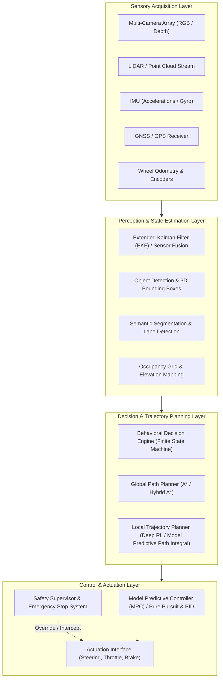

# 01 - System Architecture

## 1. High-Level Architecture Overview

The **AI-Based Autonomous Navigation System** employs a modular hybrid architecture combining deep learning-based perception and decision-making with deterministic safety, planning, and control guarantees. This design ensures both the adaptive intelligence required for complex unstructured environments and the deterministic safety constraints necessary for real-world or high-fidelity simulated deployment.

---

## 2. Core Architectural Subsystems

### 2.1 Sensory Acquisition Layer
Responsible for polling, synchronizing, and timestamp-aligning multi-modal sensor inputs:
- **RGB Cameras**: Forward-facing and surround cameras for vision, traffic signals, lane markers, and object categorization.
- **LiDAR**: 3D point cloud generation for metric depth estimation and obstacle bounding.
- **IMU & GNSS**: High-frequency angular velocity, linear acceleration, and global geographical coordinates.
- **Odometry**: Real-time vehicle speed, wheel turn rates, and heading updates.

### 2.2 Perception & State Estimation Layer
Transforms raw sensor tensors into structured semantic representations of the ego-vehicle's state and surrounding environment:
- **State Estimation (EKF)**: Fuses IMU, GNSS, and wheel odometry to maintain a continuous, low-latency estimate of ego pose $(x, y, z)$, velocity $(\dot{x}, \dot{y}, \dot{z})$, and orientation $(\phi, \theta, \psi)$.
- **Vision Pipeline**: Deep Convolutional / Vision Transformer (ViT) backbones predicting bounding boxes, 2D/3D detections, semantic masks, and lane boundaries.
- **Dynamic Occupancy Mapping**: Continuous grid mapping of traversable free-space vs occupied obstacle space.

### 2.3 Decision & Trajectory Planning Layer
Deconstructs navigation into hierarchical tiers:
- **Global Route Planning**: Discretized topological search over map waypoints (e.g., A* or Dijkstra) from origin to destination.
- **Behavioral Arbiter**: Finite State Machine (FSM) determining driving modes (e.g., *Lane Keep*, *Intersection Yield*, *Overtake*, *Emergency Stop*).
- **Local Motion Planning**: Generates collision-free, kinematically feasible trajectories over a short time horizon ($T = 3\text{--}5\text{ s}$) optimizing comfort, safety clearance, and target velocity.

### 2.4 Control & Actuation Layer
Translates trajectory waypoints into low-level steering angles $\delta(t)$, throttle percentage $\alpha(t)$, and braking pressure $\beta(t)$:
- **Lateral Controller**: Model Predictive Control (MPC) or Pure Pursuit / Stanley tracking lateral cross-track error $e_y$ and heading error $e_\psi$.
- **Longitudinal Controller**: Feedforward + PID regulator maintaining target velocity $v_{\text{target}}$ and safe time headway.
- **Safety Fallback Interceptor**: Deterministic watchdog monitoring collision time-to-impact ($TTC$), sensor heartbeat timeouts, and actuation bounds.

