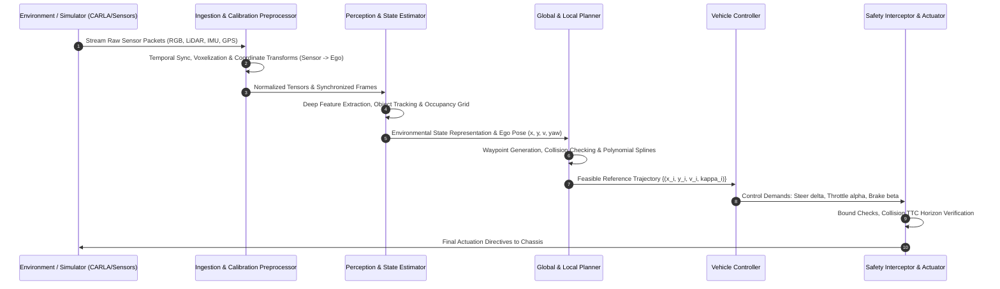

# 02 - Data Flow and Pipeline

## 1. End-to-End Data Pipeline Architecture

Data in the **AI-Based Autonomous Navigation System** flows asynchronously across decoupled rates managed by a centralized pub/sub or tick-based execution pipeline.

---

## 2. Frequency & Execution Timing

| Subsystem | Target Frequency | Latency Budget | Primary Input | Primary Output |
| :--- | :--- | :--- | :--- | :--- |
| **IMU / Odometry Ingestion** | $100\text{ Hz}$ | $\le 2\text{ ms}$ | Raw serial / CAN signals | Calibrated angular rates & accelerations |
| **State Estimation (EKF)** | $100\text{ Hz}$ | $\le 5\text{ ms}$ | IMU + GNSS + Odometry | 6-DoF Ego Pose $(x, y, z, \phi, \theta, \psi)$ & Linear Velocities |
| **Camera & LiDAR Ingestion** | $30\text{ Hz}$ | $\le 10\text{ ms}$ | Bayer/RGB frames, raw PointClouds | Preprocessed tensors, Voxel grids |
| **Deep Perception Stack** | $20\text{--}30\text{ Hz}$ | $\le 35\text{ ms}$ | Image tensors, 3D point voxels | 3D Bounding Boxes, Free-space semantics |
| **Local Motion Planner** | $10\text{--}20\text{ Hz}$ | $\le 40\text{ ms}$ | Occupancy grid, ego state, global path | Time-parameterized trajectory points |
| **Controller & Safety Loop** | $50\text{--}100\text{ Hz}$| $\le 10\text{ ms}$ | Trajectory reference, current ego state | Normalized Steering $[-1, 1]$, Throttle $[0, 1]$, Brake $[0, 1]$ |

---

## 3. Coordinate Frame Transformations

All data is transformed systematically across standardized coordinate conventions (ISO 8855 / SAE standard vehicle coordinates):

1. **Sensor Coordinate Frames ($S_{\text{cam}}, S_{\text{lidar}}$)**:
   - Camera: $X$-Right, $Y$-Down, $Z$-Forward (Optical frame).
   - LiDAR: $X$-Forward, $Y$-Left, $Z$-Up.
2. **Vehicle Ego Frame ($V_{\text{ego}}$)**:
   - Origin located at the center of the rear axle projected to ground level.
   - $X$-Forward, $Y$-Left, $Z$-Up.
   - Transformation matrix:
     $$\mathbf{T}_{\text{ego}}^{\text{sensor}} = \begin{bmatrix} \mathbf{R} & \mathbf{t} \\ \mathbf{0}^T & 1 \end{bmatrix}$$
3. **World / Global Frame ($W_{\text{map}}$)**:
   - East-North-Up (ENU) or Universal Transverse Mercator (UTM) metric coordinates for absolute navigation.

---

## 4. Preprocessing & Tensor Standardization

1. **RGB Imagery**:
   - Resized to network resolution (e.g., $640 \times 360$ or $224 \times 224$ depending on model backbone).
   - Normalized using ImageNet or domain-specific statistics:
     $$\mathbf{I}_{\text{norm}} = \frac{\mathbf{I} - \mu}{\sigma}$$
2. **LiDAR Point Clouds**:
   - Range-clipped ($x \in [0, 80]\text{ m}, y \in [-40, 40]\text{ m}, z \in [-2, 4]\text{ m}$).
   - Downsampled via Voxel Grid filtering with voxel leaf size $\delta = 0.1\text{ m}$.
3. **IMU & State Normalization**:
   - High-pass filtering for gyro drift compensation.
   - Quaternion-to-Euler conversion for trajectory representation.

