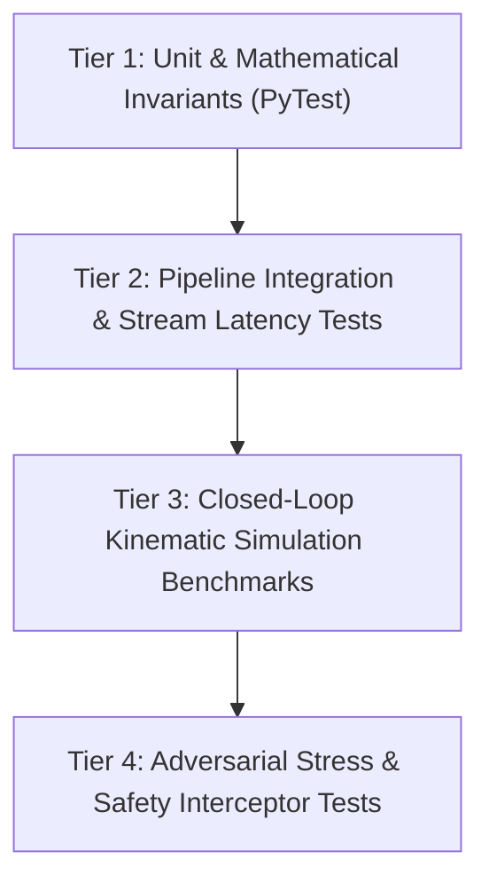

# 06 - Validation and Testing Framework

## 1. Multi-Tiered Verification Protocol

To guarantee that each implemented module functions correctly and safely, all code in this repository must satisfy a 4-tier validation pipeline:



---

## 2. Validation Tiers Breakdown

### Tier 1: Unit Tests & Invariant Assertions
- **Location**: `tests/unit/`
- **Scope**: Mathematical sanity checks without simulation overhead.
- **Key Checks**:
  - Coordinate conversions (SE3 matrix inversion, Euler to Quaternion roundtrip error $< 10^{-6}$).
  - EKF convergence on synthetic noisy trajectories (State error covariance decreases asymptotically).
  - Kinematic bicycle model integration conservation of energy & non-holonomic constraints.
  - Controller output boundaries (Steering strictly in $[-1.0, 1.0]$, throttle/brake strictly in $[0.0, 1.0]$).

### Tier 2: Pipeline Integration & Stream Latency
- **Location**: `tests/integration/`
- **Scope**: Multi-threaded/asynchronous queue synchronization and latency budgets.
- **Key Checks**:
  - Perception-to-Planning latency $\le 40\text{ ms}$.
  - End-to-end tick execution frequency stability (main loop maintains $\ge 50\text{ Hz}$).
  - Zero memory leaks across $10,000$ consecutive simulation ticks.

### Tier 3: Closed-Loop Kinematic Simulation Benchmarks
- **Location**: `tests/benchmarks/`
- **Scope**: Full driving scenarios in simulated tracks (synthetic or CARLA).
- **Core Standard Scenarios**:
  1. **Straight Cruise & Velocity Tracking**: Cruise at $15\text{ m/s}$ with speed error $< 0.2\text{ m/s}$.
  2. **Double Lane Change**: Avoid stationary obstacle with smooth re-entry; lateral acceleration $< 2.5\text{ m/s}^2$.
  3. **Sharp 90-Degree Urban Curve**: Maximum cross-track error $e_y < 0.35\text{ m}$.
  4. **Emergency Stop (AEB)**: Sudden obstacle at $30\text{ m}$ ahead; complete stop achieved with $> 1.5\text{ m}$ safety margin.

### Tier 4: Safety & Fault Injection
- **Location**: `tests/safety/`
- **Scope**: System behavior under sensor degradation or computational stalls.
- **Key Checks**:
  - GNSS dropout for $2.0\text{ s}$ -> EKF dead reckoning smoothly maintains trajectory.
  - Camera frame drop -> Safety Interceptor initiates controlled deceleration.
  - Model predicting trajectory into obstacle -> Interceptor overrides model with AEB.

---

## 3. Quantitative Pass/Fail Criteria

| Evaluation Metric | Target Threshold | Critical Failure Boundary |
| :--- | :--- | :--- |
| **Cross-Track Error ($e_y$)** | $\text{Mean } \le 0.15\text{ m}$ | $\text{Max } > 0.60\text{ m}$ |
| **Heading Error ($e_\psi$)** | $\text{Mean } \le 0.05\text{ rad}$ | $\text{Max } > 0.25\text{ rad}$ |
| **Max Lateral Acceleration ($a_y$)** | $\le 2.0\text{ m/s}^2$ | $> 3.5\text{ m/s}^2$ (Rollover / Discomfort) |
| **Max Longitudinal Jerk ($j_x$)** | $\le 1.8\text{ m/s}^3$ | $> 3.0\text{ m/s}^3$ (Passenger Discomfort) |
| **Collision Rate** | $0.0\%$ | $> 0$ (Immediate Failure) |
| **Time-to-Collision (TTC) Margin** | $\ge 2.0\text{ s}$ | $< 0.8\text{ s}$ |
| **Loop Latency** | $\le 20\text{ ms}$ | $> 50\text{ ms}$ (Missed Real-Time Deadline) |

---

## 4. How to Execute Tests

When modules are implemented, run validation using:

```powershell
# Run full suite
pytest tests/ -v

# Run unit tests only
pytest tests/unit/ -v

# Run closed-loop benchmark tests
pytest tests/benchmarks/ -v

# Run with coverage report
pytest --cov=src tests/
```

