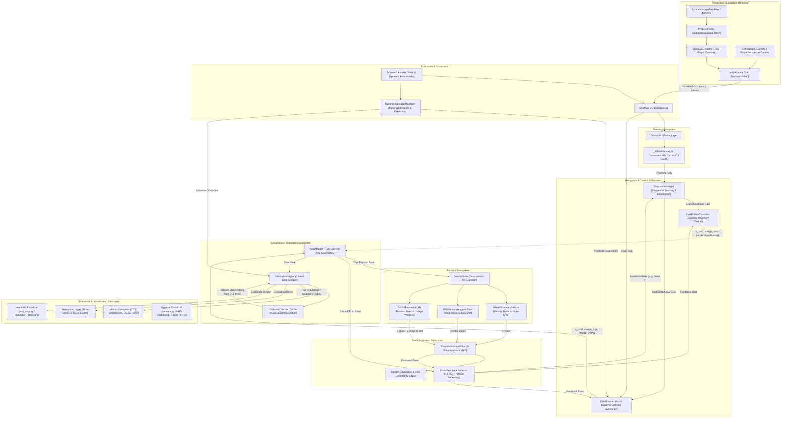

# System Architecture (Simulation-First 2D Baseline)

## 1. Architectural Overview

The **AI-Based Autonomous Navigation System** is organized as a decoupled, modular simulation platform designed for deterministic safety, rapid prototyping, and reproducible benchmarking.

---

## 2. Subsystem Boundaries and Responsibilities

### 2.1 Perception Subsystem (`autonomous_nav.perception`)
- **[`preprocessing`](../src/autonomous_nav/perception/preprocessing.py)**: Validates synthetic camera image dimensions and types, converts BGR observations to grayscale, executes noise suppression (Gaussian/Bilateral filtering), and normalizes pixel intensities.
- **[`vision`](../src/autonomous_nav/perception/vision.py)**: Defines camera models and geometric projective transformations:
  - `OrthographicCamera`: Top-down metric scale mapping $(x, y) \leftrightarrow (u, v)$ with vertical inversion and boundary checks.
  - `PlanarPerspectiveCamera`: Ground-plane Homography $\mathbf{H}$ and Inverse Perspective Mapping (IPM) for angled forward-facing sensors.
  - `CalibratedHomographyCamera`: General 4-point correspondence homography constructor for empirical ground calibration.
  - `SyntheticImageRenderer`: Deterministic rasterizer generating controlled benchmark observations of rectangular and circular obstacles.
- **[`obstacle_detection`](../src/autonomous_nav/perception/obstacle_detection.py)**: Classical OpenCV pipeline utilizing Otsu/adaptive thresholding, morphological closing/opening, contour extraction, spatial moments centroid computation, and min/max area filtering. Outputs structured `DetectionResult` and visual debug annotations.
- **[`map_adapter`](../src/autonomous_nav/perception/map_adapter.py)**: Decoupled interface synchronizing vision detections into metric `GridMap` state without coupling vision logic directly to grid mutation details. Supports filled polygon footprint rasterization (`use_full_contour=True` to prevent geometric shrinkage), boundary-safe polygon clipping, and full binary mask projection via spatial affine warp (`cv2.warpAffine`).

### 2.2 Environment Subsystem (`autonomous_nav.environment`)
- **[`GridMap`](../src/autonomous_nav/environment/grid_map.py)**: Manages 2D discrete cell occupancy grids ($0 = \text{free}$, $1 = \text{occupied}$). Provides bidirectional conversions between metric world coordinates and discrete grid indices, bounding checks, obstacle inflation, and geometric obstacle primitives (rectangles, circles).
- **[`DynamicObstacle` & `DynamicObstacleManager`](../src/autonomous_nav/environment/dynamic_obstacle.py)**: Models deterministic moving obstacles with analytical position projection (`predict_position()`, `predict_trajectory()`), trajectory replay, and aggregate distance/collision queries. Supports `linear_ping_pong`, `circular`, `waypoints`, and `constant_velocity` patterns.
- **[`scenarios`](../src/autonomous_nav/environment/scenarios.py)**: Standardized, reproducible benchmark scenarios:
  - Static: `empty_field`, `simple_obstacles`, `corridor_s_bend`, `urban_grid`.
  - Dynamic: `dynamic_crossing` (orthogonal moving obstacles), `dynamic_corridor` (diagonal crossing in constrained hallway), `dynamic_chokepoint` (periodically occluded doorway).

### 2.3 Planning Subsystem (`autonomous_nav.planning`)
- **[`AStarPlanner`](../src/autonomous_nav/planning/astar.py)**: Graph search pathfinder over 2D grid with Euclidean or Manhattan heuristic. Implements corner-cutting prevention to forbid diagonal transitions between touching obstacles.

### 2.4 Sensor Simulation Subsystem (`autonomous_nav.sensors`)
- **[`WheelOdometrySensor`](../src/autonomous_nav/sensors/sensor_models.py)**: Simulates forward wheel linear velocity ($v$) with additive Gaussian white noise $\mathcal{N}(0, \sigma_v^2)$ and systematic scaling/wheel radius calibration error.
- **[`IMUSensor`](../src/autonomous_nav/sensors/sensor_models.py)**: Simulates single-axis yaw rate gyro ($\omega$) corrupted by white noise $\mathcal{N}(0, \sigma_\omega^2)$ and a time-varying random-walk bias drift $b_{k} = b_{k-1} + \mathcal{N}(0, \sigma_b^2 \Delta t)$.
- **[`GNSSReceiver`](../src/autonomous_nav/sensors/sensor_models.py)**: Simulates low-frequency 2D absolute position fixes $(x, y)$ at configurable periodic epochs (e.g. 1 Hz), corrupted by 2D Gaussian positional noise, with support for scheduled GNSS outages (e.g., urban canyon or tunnel signal occlusion).
- **[`SensorSuite`](../src/autonomous_nav/sensors/sensor_models.py)**: Bundles sensor modules with deterministic pseudo-random number generator seeding (`seed=42`) and generates synchronized timestamped `SensorMeasurements` packets.

### 2.5 State Estimation Subsystem (`autonomous_nav.estimation`)
- **[`ExtendedKalmanFilter`](../src/autonomous_nav/estimation/ekf.py)**: Analytical 5-state Extended Kalman Filter fusing dead-reckoning kinematics and sensor updates:
  - State Vector: $\mathbf{x} = [x, y, \theta, v, b_g]^T$
  - Analytical state transition Jacobian $F = \frac{\partial f}{\partial \mathbf{x}}$
  - Covariance prediction: $P^- = F P F^T + Q$
  - Joseph-form covariance updates: $P = (I - KH)P(I - KH)^T + KRK^T$ ensuring guaranteed positive semi-definiteness and symmetry
  - Heading angle normalization within $[-\pi, \pi)$
  - Positional uncertainty ellipse parameter extraction ($a, b, \phi$) for 95% confidence intervals ($\chi_2^2 = 5.991$)

### 2.6 Navigation Subsystem (`autonomous_nav.navigation`)
- **[`WaypointManager`](../src/autonomous_nav/navigation/waypoint_manager.py)**: Maintains waypoints, tracks active index with an acceptance radius, extracts adaptive lookahead target points, and verifies goal arrival.
- **[`PurePursuitController`](../src/autonomous_nav/navigation/controller.py)**: Kinematic waypoint tracker calculating angular velocity commands ($\omega$) from heading errors ($\alpha$) and modulating linear velocity ($v$) for sharp turns and terminal deceleration. Serves as the static baseline tracker.
- **[`DWAPlanner`](../src/autonomous_nav/navigation/dwa.py)**: Dynamic Window Approach local planner (Fox et al., 1997). Generates reachable velocity search space $[v_{\min}, v_{\max}] \times [-\omega_{\max}, \omega_{\max}]$ bounded by physical acceleration limits, forward-simulates circular unicycle arcs, precomputes dynamic obstacle prediction horizons, performs spatiotemporal collision evaluation against both static AABB obstacles and projected dynamic obstacles (including continuous relative swept-distance checks), and optimizes a 3-term objective function (heading alignment, obstacle clearance, forward velocity).

### 2.7 Simulation Subsystem (`autonomous_nav.simulation`)
- **[`RobotModel`](../src/autonomous_nav/simulation/robot.py)**: Unicycle kinematic integration using 2nd-order Runge-Kutta / midpoint discretization under acceleration and velocity saturation limits.
- **[`CollisionChecker`](../src/autonomous_nav/simulation/collision.py)**: Exact geometric Circle-to-AABB (Axis-Aligned Bounding Box) intersection detection with NumPy bounding-box vector acceleration, minimum distance queries, and exact continuous relative swept-segment distance calculation to eliminate temporal tunneling between time samples.
- **[`SimulationEngine`](../src/autonomous_nav/simulation/engine.py)**: Orchestrates the closed-loop navigation execution. Integrates true physical robot kinematics, noisy sensor generation, EKF estimation, state feedback isolation (`state_feedback = "ground_truth" | "ekf" | "dead_reckoning"`), dynamic obstacle updates, and step-level telemetry. Evaluates physical collisions strictly against true ground-truth poses.

### 2.8 Evaluation & Visualization (`autonomous_nav.evaluation`, `autonomous_nav.visualization`)
- **[`metrics`](../src/autonomous_nav/evaluation/metrics.py)**: Computes path length, trajectory length, path efficiency ratio, cross-track error (mean & max), angular smoothness, velocity profiles, and state estimation error metrics (Position RMSE, Position MAE, Max Position Error, Heading RMSE, Velocity RMSE).
- **[`logger`](../src/autonomous_nav/evaluation/logger.py)**: Serializes step-by-step telemetry records to CSV and benchmark scorecard summaries to JSON.
- **[`plot_map`](../src/autonomous_nav/visualization/plot_map.py)**: Renders publication-grade 2D figures displaying grid obstacles, planned A* paths, actual robot paths, heading quivers, and goal markers.
- **[`animate`](../src/autonomous_nav/visualization/animate.py)**: Interactive 2D Pygame visualizer providing real-time rendering, live telemetry HUD (speed, angular rate, CTE, sim time, DWA mode badge, Feedback mode, Pos Error, Heading Error, Gyro Bias, GNSS Fix count), dynamic obstacle visualization with predicted trails, active DWA trajectory arcs, estimated robot pose outline with 95% position uncertainty ellipse, recent GNSS fix crosshairs, keyboard controls (Pause, Step, Reset, Switch Scenario, Toggle Nav Mode `[M]`, Toggle Feedback Mode `[E]`), and interactive mouse click obstacle placement.

### 2.9 High-Fidelity Simulation Bridge Subsystem (`autonomous_nav.bridge`)
- **[`contracts`](../src/autonomous_nav/bridge/contracts.py)**: Strongly-typed, timestamped message definitions adhering strictly to robotics standards (REP-103 / REP-105):
  - `TimestampedRobotState`: 3D Cartesian coordinates $(x, y, z)$ in meters, Euler orientations $(\text{roll}, \text{pitch}, \text{yaw})$ in radians, linear velocities $(v_x, v_y, v_z)$, forward speed $v$, yaw rate $\omega$, timestamp in seconds, and explicit `frame_id` / `child_frame_id`.
  - `NavigationCommand`: Commanded longitudinal velocity $v_{\text{cmd}}$ and angular rate $\omega_{\text{cmd}}$, timestamp, and sequence ID with built-in limit validation and clamping.
  - `OdometryObservation`, `ImuObservation`, `GnssObservation`, `LaserScanObservation`: Sensor packets capturing noisy observations with explicit frame IDs and validity flags.
  - `SimulatorSensorPacket`: Synchronous container aggregating all sensor observations at a simulation time step.
  - `SimulatorCapabilities`: Profile detailing simulator engine, supported coordinate frames, available sensors, clock source, and lockstep stepping support.
  - `SimulationLifecycleState`: Formal state enum (`UNINITIALIZED`, `READY`, `RUNNING`, `PAUSED`, `STOPPED`, `ERROR`).
- **[`interface`](../src/autonomous_nav/bridge/interface.py)**: `SimulationBridge` abstract base class defining lifecycle hooks (`connect`, `initialize`, `step`, `reset`, `disconnect`), actuation dispatch (`send_command`), telemetry inspection (`get_capabilities`, `is_healthy`), and strict separation between evaluation truth (`get_ground_truth_state`) and navigation feedback (`get_sensor_observations`).
- **[`mock_adapter`](../src/autonomous_nav/bridge/mock_adapter.py)**: `OfflineTestAdapter` deterministic mock implementation. Simulates 3D/planar unicycle kinematics, synthetic odometry/IMU/GNSS noise, and raymarching planar LiDAR returns against `GridMap` obstacles. Enforces frame validation, command limits, and timestamp monotonicity.
- **[`mapping`](../src/autonomous_nav/bridge/mapping.py)**: Decoupled translation layer:
  - `state_3d_to_2d_robot_state`: Projects 3D state contracts to 2D planar `RobotState`.
  - `robot_state_to_3d_state`: Lifts 2D poses to 3D `TimestampedRobotState`.
  - `packet_to_sensor_measurements`: Translates `SimulatorSensorPacket` directly into `SensorMeasurements` for EKF consumption.
  - `laser_scan_to_grid_map`: Projects planar LiDAR range scans into 2D discrete `GridMap` cells.
  - `quaternion_to_euler` / `euler_to_quaternion`: Mathematical conversions between unit quaternions $(q_x, q_y, q_z, q_w)$ and Euler angles $(\phi, \theta, \psi)$.

### 2.9 Real-World Dataset Subsystem (`autonomous_nav.datasets`)
- **[`config`](../src/autonomous_nav/datasets/config.py)**: `CameraIntrinsics` (focal lengths $f_x, f_y$, principal point $c_x, c_y$, image dimensions, distortion coefficients), `SensorExtrinsics` (body-to-camera translation $d_x, d_y, d_z$ and rotation angles), and `DatasetConfig` (depth scale factor 5000.0, height filtering $[0.05, 1.20]\text{ m}$, camera mounting geometry).
- **[`groundtruth`](../src/autonomous_nav/datasets/groundtruth.py)**: `GroundTruthPose` (with quaternion yaw extraction and conversion to `RobotState`) and `GroundTruthTrajectory` (parsing TUM groundtruth.txt, timestamp indexing, nearest-neighbor query, spherical linear interpolation SLERP, path statistics).
- **[`depth_projection`](../src/autonomous_nav/datasets/depth_projection.py)**: Pinhole back-projection pipeline:
  - `load_depth_image`: 16-bit uint16 PNG loader returning depth in meters ($Z_c = \text{raw} / 5000.0$).
  - `depth_to_pointcloud_camera`: Back-projects depth pixels to 3D camera coordinates: $X_c = (u - c_x) Z_c / f_x$, $Y_c = (v - c_y) Z_c / f_y$.
  - `transform_camera_to_body`: Transforms points from optical frame ($+X$ right, $+Y$ down, $+Z$ forward) to REP-105 robot body frame ($+X$ forward, $+Y$ left, $+Z$ up).
  - `filter_obstacle_height`: Rejects floor points ($Z_b < 0.05\text{ m}$) and high ceiling/overhead points ($Z_b > 1.20\text{ m}$).
  - `project_body_to_world`: Transforms robot body point cloud to global world frame given robot pose $(x, y, \theta)$.
  - `insert_points_into_grid_map`: Rasterizes metric world points into discrete 2D `GridMap` cells.
- **[`adapter`](../src/autonomous_nav/datasets/adapter.py)**: `TUMRGBDAdapter` orchestrating dataset file discovery, ground truth trajectory loading, frame projection, and closed-loop trajectory tracking evaluation against real-world ground truth.

---

## 3. Hierarchical Architecture: Global Planning vs. Local Reactive Avoidance

The navigation stack implements a two-tiered hierarchical architecture cleanly separating route planning from real-time motion control:

| Layer | Component | Rate | Search Space | Objective | Handles |
| :--- | :--- | :--- | :--- | :--- | :--- |
| **Global Planner** | `AStarPlanner` | On start / On map mutation ($< 1\text{ Hz}$) | Full 2D Grid ($x, y$) | Find shortest collision-free topological path to goal | Static geometry, room connectivity, maze routing |
| **Local Planner** | `DWAPlanner` | Every control step ($10\text{ Hz}$, $dt=0.1\text{ s}$) | Velocity Space $(v, \omega)$ | Select dynamically admissible $(v, \omega)$ maximizing progress & safety | Moving obstacles, dynamic clearance, robot kinematics & acceleration limits |
| **Kinematic Plant** | `RobotModel` & `SimulationEngine` | High-frequency update ($10\text{ Hz}$) | State Space $(x, y, \theta, v)$ | Discrete Euler/RK2 physical integration & collision checks | Acceleration limits, simulated physics clock |

