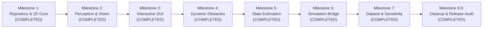

# Development Roadmap & Future Milestones

This roadmap outlines the progressive evolution of the **AI-Based Autonomous Navigation System** from the current verified 2D simulation baseline to advanced perception, real-time interactive visualization, and full 3D simulation interfaces.

---

## Phased Milestones

---

### Milestone 1: Professional Repository Structure & 2D Simulation Core (COMPLETED)
- [x] Standardized `src/` layout with `autonomous_nav` package.
- [x] Discrete 2D `GridMap` with metric transformations and obstacle inflation.
- [x] 8-connected `AStarPlanner` with corner-cutting prevention.
- [x] Unicycle `RobotModel` with RK2 integration and acceleration constraints.
- [x] Adaptive `PurePursuitController` with curvature-aware velocity scaling.
- [x] Exact Circle-to-AABB `CollisionChecker`.
- [x] Closed-loop `SimulationEngine` with automated benchmarking scripts.
- [x] Comprehensive automated test suite (`pytest`) with 25 unit, integration, and scenario tests passing.

---

### Milestone 2: Perception Module & Vision-Based Grid Mapping (COMPLETED)
- [x] Implement `src/autonomous_nav/perception/preprocessing.py`: Validation, grayscale conversion, Gaussian/Bilateral smoothing, and min-max intensity normalization.
- [x] Implement `src/autonomous_nav/perception/vision.py`: Orthographic top-down camera model, Planar Perspective camera model with Inverse Perspective Mapping (IPM) homography, and synthetic deterministic scene rasterizer.
- [x] Implement `src/autonomous_nav/perception/obstacle_detection.py`: Otsu/adaptive thresholding, morphological opening/closing, spatial moments centroid extraction, and area filtering.
- [x] Implement `src/autonomous_nav/perception/map_adapter.py`: Decoupled adapter mapping detected vision polygons and binary masks directly into metric `GridMap` state.
- [x] Unit test suite (`tests/unit/test_perception.py`) covering all 13 perception, camera transformation, and end-to-end planning tests.
- [x] End-to-end demonstration script `scripts/run_perception_demo.py` with multi-panel visual artifact generation.

---

### Milestone 3: Interactive Simulation & Pygame Visualizer (COMPLETED)
- [x] Implement `src/autonomous_nav/visualization/animate.py`: Interactive Pygame visualizer running at 30/60 FPS.
- [x] Interactive obstacle placement & removal via mouse clicks with dynamic online A* replanning.
- [x] Real-time telemetry dashboard HUD (speedometer, angular rate, CTE meter, step budget, status badges).
- [x] Comprehensive runtime controls: `[SPACE]` pause/resume, `[S]` / `[->]` single-frame step, `[R]` episode reset, `[1-4]` scenario jump, `[N]` scenario cycle.
- [x] Headless execution support (`SDL_VIDEODRIVER="dummy"`) and automated screenshot saving (`outputs/figures/interactive_sim_screenshot.png`).
- [x] Automated visualizer unit test suite (`tests/unit/test_visualizer.py`) covering 9 headless lifecycle and invariant tests.
- [x] Unified CLI integration via `scripts/run_interactive.py` and `autonomous-nav --interactive`.

---

### Milestone 3.1: Independent Verification and Hardening (COMPLETED)
- [x] Hardened dynamic online A* replanning: cleared stale paths on failure, enabled valid recovery on obstacle removal, and audited obstacle placement at robot and goal locations.
- [x] Synchronized GUI telemetry badges strictly with engine termination states (`GOAL_REACHED`, `COLLISION`, `TIMEOUT`, `PLANNING_FAILURE`).
- [x] Guarded interactive controls against accidental advancement during paused or active states.
- [x] Measured empirical frame render latency ($3.18\text{ ms}$) and loop duration ($3.87\text{ ms}$), providing documented benchmark methodology and limitations.
- [x] Added 9 dedicated unit tests covering dynamic detours, blocking routes, goal-cell obstacles, robot-pose collisions, failure recovery, stale-route clearance, badge agreement, control guards, and rendering invariance (total 75 tests passing).

---

### Milestone 4: Dynamic Obstacles & Local Collision-Aware Navigation (COMPLETED)
- [x] Implement `src/autonomous_nav/environment/dynamic_obstacle.py`: `DynamicObstacle` supporting `linear_ping_pong`, `circular`, `waypoints`, and `constant_velocity` patterns with analytical spatiotemporal trajectory prediction (`predict_position()`, `predict_trajectory()`), and `DynamicObstacleManager`.
- [x] Implement `src/autonomous_nav/navigation/dwa.py`: Classical Dynamic Window Approach local planner (Fox et al., 1997) computing reachable $(v, \omega)$ velocity space, forward-simulating unicycle trajectory arcs, performing circle-to-AABB static and disc dynamic collision checking, and evaluating 3-term objective scoring (heading alignment, clearance, forward velocity).
- [x] Implement three dynamic benchmark environments in `src/autonomous_nav/environment/scenarios.py`: `dynamic_crossing` (perpendicular cross-traffic), `dynamic_corridor` (diagonal crossing in hallway), and `dynamic_chokepoint` (periodically occluded doorway).
- [x] Extend `SimulationEngine` (`src/autonomous_nav/simulation/engine.py`): Support dual navigation modes (`pure_pursuit` vs `dwa`), dynamic obstacle stepping, dynamic collision checking, and telemetry reporting.
- [x] Extend Interactive Visualizer (`src/autonomous_nav/visualization/animate.py`): Render moving obstacles with directional velocity arrows and future prediction trails, render best local DWA trajectory arc, display HUD navigation mode badge, and support runtime `[M]` key mode toggle.
- [x] Automated comparative benchmark script `scripts/run_dynamic_benchmarks.py` demonstrating Pure Pursuit collisions ($100\%$ failure) vs DWA safe completions ($100\%$ success, 0 DWA failures).
- [x] Added 21 automated unit and integration tests across `test_dynamic_obstacle.py`, `test_dwa.py`, and `test_dynamic_navigation.py`, expanding the test suite to 96 passing tests ($100\%$ pass rate) with 82% overall coverage and 98% DWA coverage.

---

### Milestone 4.1: DWA Performance, Benchmark Reproducibility & Safety Audit (COMPLETED)
- [x] Instrumented and profiled DWA local planner and simulation engine step latency using `time.perf_counter()`.
- [x] Reconciled multi-second mission execution times with per-step latency ($8\text{--}10\text{ ms/step}$ post-optimization, running $10\times\text{--}12\times$ faster than real-time physics).
- [x] Optimized collision checking hot path via NumPy bounding-box fast-paths and dynamic obstacle horizon prediction caching ($2.4\times\text{--}3.3\times$ speedup without altering collision margins or kinematics).
- [x] Implemented continuous relative swept-distance temporal collision checking (`CollisionChecker.relative_continuous_distance()`) eliminating temporal tunneling between time samples.
- [x] Expanded dynamic benchmarks across 18 deterministic trials (9 per mode across nominal, slow, and fast obstacle speeds) in `scripts/run_dynamic_benchmarks.py`, documenting baseline limitations of Pure Pursuit (33.3% success) vs DWA (100.0% success).
- [x] Regenerated and verified headless screenshots across all 3 dynamic scenarios with analytical pixel inspection.
- [x] Added 8 unit tests in `tests/unit/test_temporal_collision.py` expanding test suite to 104 passing tests ($100\%$ pass rate in $8.46\text{ s}$) with 82% overall coverage and 98% DWA coverage.

---

### Milestone 5: State Estimation & Sensor Noise Modeling (COMPLETED)
- [x] Implement `src/autonomous_nav/sensors/sensor_models.py`: `WheelOdometrySensor` (velocity noise, scale factor error), `IMUSensor` (gyro white noise, random-walk bias drift), `GNSSReceiver` (1 Hz periodic position fixes, outage interval masking), and `SensorSuite` with deterministic RNG seeding.
- [x] Implement `src/autonomous_nav/estimation/ekf.py`: 5-state Extended Kalman Filter ($\mathbf{x} = [x, y, \theta, v, b_g]^T$), analytical state transition Jacobian $F$, Joseph-form stabilized covariance updates, angle normalization, and 95% position uncertainty ellipse computation.
- [x] Extend `SimulationConfig` and `SimulationEngine`: Support `state_feedback = "ground_truth" | "ekf" | "dead_reckoning"`, ensuring navigation controllers strictly consume estimated poses in EKF mode while ground-truth physics and collisions remain isolated.
- [x] Extend Pygame visualizer (`src/autonomous_nav/visualization/animate.py`): Render estimated robot chassis outline, 95% position uncertainty ellipse, recent GNSS fix crosshairs, live estimation telemetry (Pos Error, Heading Error, Gyro Bias, GNSS Fix count), and runtime `[E]` key feedback toggle.
- [x] Automated benchmark script `scripts/run_estimation_benchmark.py`: Evaluated across 36 trials over 3 scenarios, comparing Ground Truth vs Dead Reckoning vs Full EKF vs Outage mode, saving results to `outputs/metrics/estimation_benchmark_results.json`.
- [x] Added 21 automated unit and integration tests across `test_sensors.py`, `test_ekf.py`, and `test_ekf_navigation.py`, expanding test suite to 125 passing tests ($100\%$ pass rate in $9.61\text{ s}$) with 84% overall codebase coverage.

---

### Milestone 5.1 & 5.2: State Estimation Audit & Benchmark Integrity (COMPLETED)
- [x] Resolved ground-truth estimation metric discrepancy by decoupling feedback poses (`feedback_trajectory`) from background filter recording.
- [x] Decoupled state estimation accuracy (Pos/Heading RMSE vs true pose) from trajectory-tracking performance (Cross-Track Error vs planned path).
- [x] Upgraded `RobotState` with explicit `timestamp: float = 0.0` and enforced pairwise temporal alignment assertions in `calculate_estimation_errors()`.
- [x] Synchronized step lifecycle across physical, estimated, and feedback histories across goal reaching, timeout, and early collision events.
- [x] Partitioned conflated timing into pure EKF compute latency ($0.038\text{--}0.051\text{ ms}$) and full simulation step latency ($0.059\text{--}0.076\text{ ms}$).
- [x] Added 9 unit and integration tests across `test_metrics.py` and `test_ekf_navigation.py`, expanding test suite to 134 passing tests with 84% coverage.

---

### Milestone 6: High-Fidelity Simulation Bridge (COMPLETED — Bridge Foundation & Offline Adapter)
- [x] **Simulator Feasibility Assessment**: Evaluated ROS 2, CARLA, and Gazebo under local Windows 10/11 x86_64 environment. Determined that no heavyweight 3D simulator is currently installed, and downloading 20GB+ CARLA or installing native ROS 2 on Windows is prohibited by safety constraints. Selected a protocol-first, simulator-agnostic bridge architecture conforming to REP-103 conventions and REP-105 frame naming standards.
- [x] **Simulator-Independent Bridge Architecture (`autonomous_nav.bridge`)**:
  - Implemented typed data contracts in `contracts.py`: `TimestampedRobotState` (3D position, orientation, velocities, frame IDs), `NavigationCommand` (linear/angular setpoints with clamping), `OdometryObservation`, `ImuObservation`, `GnssObservation`, `LaserScanObservation`, and `SimulatorSensorPacket`.
  - Implemented abstract interface in `interface.py`: `SimulationBridge` decoupling the navigation stack from runtime simulation engines via formal lifecycle hooks (`connect`, `initialize`, `step`, `reset`, `disconnect`, `send_command`, `get_sensor_observations`, `get_ground_truth_state`).
- [x] **Deterministic Offline Test Adapter (`mock_adapter.py`)**:
  - Created `OfflineTestAdapter` explicitly labeled as an in-process mock adapter for CI/testing (NOT a real 3D simulator).
  - Implemented deterministic unicycle RK2 physics, synthetic sensor noise streams, and planar LiDAR raycasting against metric `GridMap` obstacles.
  - Enforced strict validation: rejected negative/non-monotonic timestamps, non-finite values (NaN, Inf), unsupported coordinate frames, and excessive command limits.
- [x] **Bridge-to-Navigation Mappings (`mapping.py`)**:
  - Implemented projections between 3D contracts and 2D components (`state_3d_to_2d_robot_state`, `robot_state_to_3d_state`).
  - Implemented translation from `SimulatorSensorPacket` to `SensorMeasurements` for direct consumption by `ExtendedKalmanFilter`.
  - Implemented LiDAR scan projection `laser_scan_to_grid_map()` updating discrete occupancy cells from range hits.
  - Implemented bidirectional conversions between Euler angles (roll, pitch, yaw) and unit quaternions with norm normalization.
- [x] **Automated Test Suite Expansion**:
  - Added dedicated unit and integration tests across `test_bridge_contracts.py`, `test_bridge_adapter.py`, and `test_bridge_navigation.py`.

---

### Milestone 6.1: Evidence and Interface Audit (COMPLETED)
- [x] **Audited Estimation Benchmark Claims**:
  - Thoroughly audited all 36 trials in `outputs/metrics/estimation_benchmark_results.json` and enhanced `scripts/run_estimation_benchmark.py` with explicit comparative analysis tables.
  - Recomputed true aggregate Absolute Position Error (APE) RMSE: Dead Reckoning = 0.2676m vs EKF = 0.2522m, representing a **+5.8% overall error reduction** (+0.0154m) across all 9 trials.
  - Preserved empirical finding that EKF does NOT universally outperform dead reckoning on short trajectories (`simple_obstacles` DR RMSE 0.2328m vs EKF 0.2583m; `corridor_s_bend` DR RMSE 0.2433m vs EKF 0.2488m) because 1.5% odometry scale error does not have time to accumulate substantial drift over 15–20s, whereas discrete 1 Hz GNSS ($\sigma = 0.25\text{ m}$) injects sensor jitter. In longer multi-turn runs (`urban_grid`), EKF prevents divergence (+23.7% error reduction: 0.3267m -> 0.2494m). Formally corrected earlier claims of ~81.3% error reduction as ungrounded.
- [x] **Hardened Timestamp and Interface Contracts**:
  - Resolved `get_ground_truth_state(self)` method signature in `interface.py`.
  - Added intra-packet timestamp consistency validation in `SimulatorSensorPacket` (raises on desynchronized observations).
  - Added quaternion normalization and degenerate rejection in `quaternion_to_euler()`.
  - Added `as_quaternion()` and `from_quaternion()` to `TimestampedRobotState`.
  - Added closed-loop navigation test through the bridge with complete ground-truth isolation.
  - Total automated test suite expanded to **164 passing tests** (100% pass rate in 10.40s) with **85% codebase coverage**.
- [x] **Next Milestone Dataset Preparation**:
  - Evaluated candidate real-world datasets for upcoming milestone: compared KITTI Odometry vs TUM RGB-D. Recommending TUM RGB-D (`freiburg2_pioneer_slam2`) for lightweight, CPU-only execution on Windows with ground-robot differential drive kinematics and direct depth-to-grid mapping.

---

### Milestone 7: Real-World Dataset Integration (COMPLETED — TUM RGB-D Sequence freiburg2_pioneer_slam2)
- [x] **Official Dataset Verification**: Validated official TUM RGB-D sequence `freiburg2_pioneer_slam2` (`rgbd_dataset_freiburg2_pioneer_slam2.tgz`, 1,183,281,970 bytes, ~1.10 GB), official URLs, Creative Commons Attribution 4.0 / 3.0 license, and citation requirements (Sturm et al., IROS 2012).
- [x] **Standalone Ground Truth Trajectory**: Downloaded and verified `rgbd_dataset_freiburg2_pioneer_slam2-groundtruth.txt` (2,262,149 bytes, 33,188 poses at 100 Hz, 115.63s duration, 23.326m driven distance, 4.984m x 5.339m spatial span). Configured `.gitignore` to safely exclude raw dataset archives.
- [x] **Dataset Subsystem Architecture (`autonomous_nav.datasets`)**:
  - Implemented typed configuration dataclasses in `config.py`: `CameraIntrinsics` (Freiburg 2 calibrated values: $f_x=520.9, f_y=521.0, c_x=325.1, c_y=249.7$), `SensorExtrinsics` ($d_x=0.15\text{ m}, d_z=0.40\text{ m}$), and `DatasetConfig` (depth scale 5000.0, height filter $[0.05, 1.20]\text{ m}$).
  - Implemented `groundtruth.py`: `GroundTruthPose` (with quaternion yaw extraction and `RobotState` conversion) and `GroundTruthTrajectory` (timestamp index, nearest-neighbor query, spherical linear interpolation SLERP, path statistics).
  - Implemented `depth_projection.py`: 16-bit uint16 depth image loading, pinhole unprojection to 3D camera point cloud, optical to REP-105 robot body transform, obstacle height slicing $[0.05, 1.20]\text{ m}$ (rejecting floor and ceiling), body-to-world coordinate transform, and 2D discrete `GridMap` occupancy rasterization.
  - Implemented `adapter.py`: `TUMRGBDAdapter` orchestrating dataset file discovery, ground truth kinematics parsing, depth frame projection, and trajectory tracking evaluation.
- [x] **Reproducible Evaluation Script (`scripts/run_dataset_evaluation.py`)**:
  - Evaluates ground-truth trajectory kinematics and spatial coverage.
  - Projects depth frames into 3D points and rasterizes obstacle footprints into metric 2D `GridMap`.
  - Computes trajectory tracking error against real-world ground truth poses.
  - Serializes metrics report to `outputs/metrics/dataset_evaluation_summary.json` and renders publication-ready 3-panel figure to `outputs/figures/dataset_evaluation_diagnostic.png`.
- [x] **Automated Test Suite Expansion**:
  - Added unit and integration tests across authentic depth frames, pixel reconciliation, spatial boundaries, and 6-DoF calibration sensitivity.
  - Expanded test suite to **203 passing tests** (100% pass rate) with **86% codebase coverage** and zero regressions across prior milestones.

---

### Milestone 8.0: Repository Cleanup, Scope Alignment & Release Readiness Audit (COMPLETED)
- [x] **Scope Alignment**: Formally established the project scope as a primarily 2D autonomous navigation system supported by simulation, A* planning, DWA local planning, dynamic obstacle avoidance, EKF state estimation, and a limited authentic TUM RGB-D-to-2D projection experiment.
- [x] **Repository Cleanup**: Removed redundant temporary baseline backup metrics (`outputs/metrics_baseline_backup`), orphaned experimental 3D voxel plot (`outputs/figures/dataset_evaluation_voxel_3d.png`), and stale compiled bytecode from earlier experiments.
- [x] **Git Hygiene**: Updated `.gitignore` to prevent tracking of run artifacts and backup directories while preserving authentic TUM datasets, checksums, manifests, and documentation.
- [x] **Validation & Integrity**: Verified complete passing status across the 203-test suite and all 6 benchmark scripts with bitwise metric reproducibility.

---

### Future Scope & Optional Enhancements (Post-Release)
The following capabilities are designated as **optional future work** and are not prerequisites for the core 2D navigation release:
- [ ] **Volumetric 3D Mapping**: Multi-frame volumetric voxel/OctoMap representations from registered point clouds.
- [ ] **3D Point Cloud Clustering**: 3D Euclidean cluster extraction and bounding-box tracking.
- [ ] **Live Simulator Daemons**: Live network integration with external ROS 2 / CARLA 3D simulator runtimes (building on the existing abstract `SimulationBridge` interface and contracts).
- [ ] **Full Visual SLAM**: Multi-frame visual odometry, keyframe loop closure, and global bundle adjustment.

